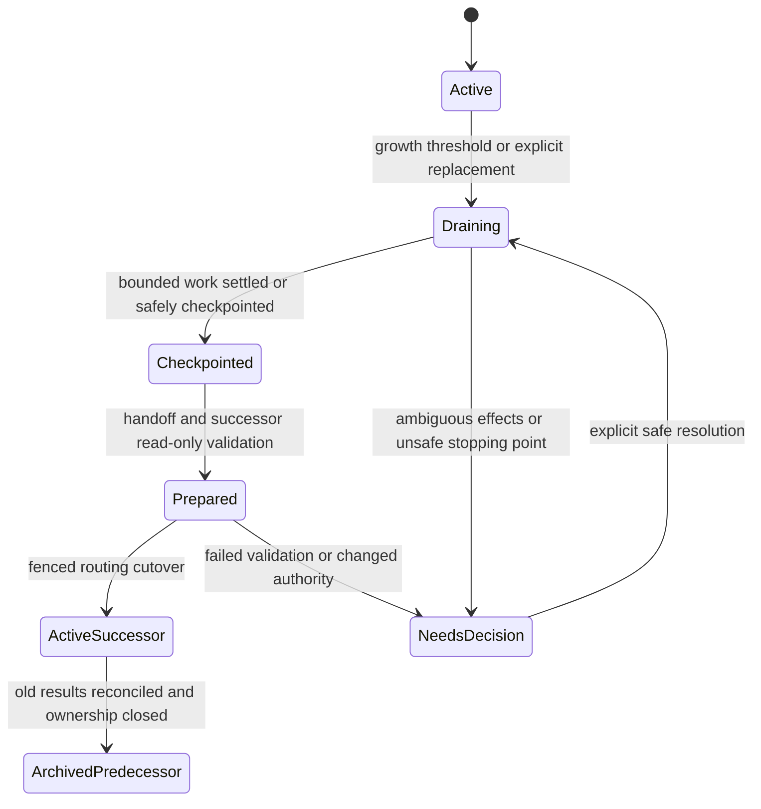

# Context budgets, wind-down, and agent replacement

Status: **proposed design for explicit Astra review**, not an implemented lifecycle or an upstream Pi Durable guarantee. The operator requires frugal, distributed contexts and an upper range of roughly 300–400K tokens rather than endlessly growing sessions.

## Goals

- Keep normal working contexts well below the upper range, distributed by responsibility with minimal unnecessary overlap.
- Begin wind-down early enough to checkpoint and brief a successor safely; do not discover the problem at a provider rejection or mid-mutation.
- Preserve the logical agent's address, authority, work references, and human-facing continuity while replacing its expensive conversation context.
- Route peers and late results correctly, with one active mutation owner and no lost or repeated work.
- Preserve evidence and access to history without putting the full historical transcript into the successor's prompt.

This is not solved merely by giving the model a larger window or summarizing everything into another giant window.

## Separate identities and lifetimes

| Identity | Lifetime and purpose |
| --- | --- |
| Project / workstream | Shared goals, dependencies, authority, artifacts |
| Logical agent address | Stable destination humans/peers use, independent of one conversation; multiple agents may share a role |
| Incarnation / routing epoch | One active execution identity behind that address; changes at replacement |
| Conversation | Persisted transcript and context for an incarnation; archived conversations remain inspectable |
| Work item / task / external operation | Own identity and effect state; must not be silently recreated at cutover |
| Client attachment | A view/controller connection, not the lifetime owner |

An illustrative mapping is `logical agent → active incarnation + epoch + conversation`. It is host application state, not a native aliasing feature we have verified in Durable. Names in this document are design vocabulary, not frozen APIs.

Humans address the logical agent. Inspection can explicitly select an older incarnation; old conversation inspection must not accidentally start an obsolete writer. Intentional historical reactivation needs separate authority and ownership checks.

## Context budgeting

Count what the next model request actually needs: system/tool declarations, loaded project/skill material, selected conversation history, attachments, queued steering, bounded tool outputs, and reserved generation output. Cached tokens still occupy context even when their price is lower.

- Aim for **normal operation below 300K**. A role/project may select a ceiling in the operator's 300–400K upper range, but do not plan beyond **400K** or a model's smaller usable limit.
- Use the smaller of the selected ceiling and the provider/model window, then reserve space for output, control messages, tool results, and handoff. A provider's nominal window is not all available for input.
- Start draining materially before that ceiling. Thresholds should use both absolute counts and fraction of the model's usable window; a smaller model must not inherit a 300K trigger.
- An illustrative large-window policy starts preparation around 240–250K, aims to finish replacement by 280–300K, and rejects ordinary new work before the chosen hard ceiling. **These values are a review starting point, not accepted defaults or measured optima.**
- Predict growth before admitting a large read/tool batch or another task, not only after the next answer. Cap model-facing outputs and keep full artifacts outside context.
- Near the ceiling, admit only a bounded checkpoint/control path with reserved headroom. Do not run a giant last-minute summarization over the whole transcript just to escape it.
- Report counts as measured/provider-reported/estimated and include uncertainty. If exact tokenization or remaining growth is unknown, use conservative margins and visible controls rather than claim an exact safety proof.

Context is one resource alongside rate limits, spend, turn count, and actual task progress. Time-based rotation alone is insufficient. Rollover churn has costs too: measure it rather than reflexively replace every idle agent.

## Distribution and overlap

A coordinator keeps goals, topology, decisions, and outcome pointers; an implementer loads bounded source/test detail; an adviser loads the evidence needed to challenge a particular claim. Exact role boundaries are configurable.

- Share compact contracts and artifact references, not every transcript/source tree.
- Read by relevant path/section/revision, with bounded retrieval on demand.
- Keep an ownership/context map: who holds which detail, its authoritative artifact, freshness, and who needs an update when it changes.
- A successor gets its current scope plus a minimal common project core, not the entire ensemble's memory.
- Some overlap is necessary for independent verification. Minimal overlap does not mean a reviewer must trust an author's summary or lacks access to primary evidence.
- Track repeated loading of the same large artifacts as an overlap signal; it is not automatically useless duplication. Do not invent a precise semantic-overlap metric without validation.

The same selective-reading rules apply to project Markdown; see [project structure](project-structure.md).

## Horizontal scaling uses the same bounded work substrate

Rollover replaces a context; horizontal allocation creates distinct worker assignments. Use project Markdown as revision-aware shared knowledge and [bounded task/continuation envelopes](task-contract.md) to bridge both. Do not distribute work by cloning a large parent conversation or continually appending instructions for the next bit.

The driver should split work before its estimated working set would exhaust a worker, choose a suitable existing or fresh context, and track dependencies/results through compact metadata. Host admission still enforces limits; model orchestration alone is not a safety guarantee.

Routing is both logical-agent-aware and work-item-aware. Rollover changes an incarnation behind one address; task splitting/reassignment needs explicit per-item ownership, lineage, and result routes. A late reply to a predecessor remains evidence for its original work item, not an instruction broadcast to every new worker.

## Proposed rollover protocol

The diagram describes the rollover operation, not a claim that the successor itself becomes the archived predecessor.

### 1. Mark draining and control admission

Persist the reason, current routing epoch, active work, and allowed completion/checkpoint scope. Notify the driving agent and expose the state to clients. Stop assigning new substantive work to this incarnation; queue ordinary messages against the logical address with a visible state. Keep stop, urgent steering, and decision resolution available.

Do not continue draining forever by accepting peer "one small thing" messages. Equally, do not kill a mutation merely to satisfy a token threshold. Capture an unsafe/ambiguous boundary and escalate if a safe checkpoint cannot be reached with reserved context.

### 2. Settle or explicitly account for in-flight work

Inventory active tools, tasks/children, external operations, worktree writer ownership, pending questions/approvals, accepted messages, and outstanding replies.

Prefer bounded completion at a safe boundary. Never represent an interrupted external action as "not done" without checking. If tasks can outlive the old conversation, use explicit host-level ownership and correlation; do not assume Durable automatically transfers task ownership between conversations. Unsupported transfer is a visible blocked case, not a hidden respawn.

### 3. Write a compact handoff manifest

Recommended content:

- Logical address, predecessor conversation/incarnation/epoch, scope and authority revision.
- Current objective, acceptance criteria, priorities, and responsible driver(s).
- Verified accomplishments, unresolved questions, assumptions clearly marked, and rejected approaches with concise reasons.
- Artifact/source pointers with relevant revisions; worktree/branch/HEAD, dirty/staged state, test status, pending external changes.
- Exact active work, operation IDs/receipts, child references, unanswered messages/decisions, and approval scope/expiry/revision.
- Known hazards, stale evidence, what must not be repeated, and the next bounded action.

A summary is a claim, not authority. Reference accepted decisions and independently checkable evidence. Do not smuggle a mistaken assumption into the successor as a ratified requirement or copy hidden/private reasoning as the handoff.

Keep the manifest small and versioned. Link deeper findings/history rather than expanding it forever. Confidentiality and credentials follow the host's existing boundaries.

### 4. Prepare and verify the successor

Create a fresh conversation/incarnation using only its role policy, minimal project core, and handoff pointers. It initially has no write/external mutation authority and receives no ordinary peer work.

Check that it can identify current scope, unresolved decisions, ownership, and the next action from artifacts. Deterministic checks compare manifest revisions, workspace state, active operation records, and routing epoch. A read-only source/driver/human review can inspect material discrepancies. Jev may help flag an inconsistency, but is not proof of correctness or approval to activate.

If live state changed or critical knowledge is missing, repair the handoff or ask the decision owner. Do not copy the entire predecessor transcript to make readiness appear easy.

### 5. Fence and switch routing

A host-controlled, revision-checked cutover records the new active incarnation/epoch only when readiness and ownership conditions hold. The old incarnation loses new-work and mutation authority. Do not assume an OS process is fenced merely because a database pointer changed: already-started tools need explicit settlement/isolation and stale-epoch checks at actual mutation/admission boundaries.

Peers normally continue addressing the same logical agent. Routine rollover/briefing should be host-driven within configured authority, not require manual spin-up or user-managed session suffixes; internal epochs/IDs remain necessary. Use the [scoped continuation map](task-contract.md#shared-continuation-map-with-scoped-agent-views) for common-plus-agent-focus briefing. Notify the responsible driver(s) and any holders of direct conversation handles of the new epoch and current state. Attached clients can follow the logical address automatically and show the replacement/handoff event, while historical views remain explicit.

Pending messages need an exact admission protocol: stable logical message IDs, a committed routing decision, and deduplicated delivery/outbox semantics. Already-injected input in the predecessor's inbox must be inventoried—not silently re-injected into the successor as fresh work. A race between input admission and routing cutover is a first-class test case.

This protocol is not yet implemented. A single host store can make its own routing updates atomic; that alone cannot atomically move built-in inbox state, filesystem effects, provider requests, or foreign services.

### 6. Reconcile late results and archive

Results retain original work/message/operation and incarnation IDs. Route useful results to the current responsible work item/driver with provenance, not by blindly triggering another obsolete agent turn. Deduplicate and classify stale results; do not drop them merely for being old or replay their original task.

Archive the predecessor as inspectable history after its ownership is safely closed. Retain only as much state/artifact material as policy permits. No second live writer should remain hidden behind the same logical address.

## Compaction, reset, replacement

Pi Durable documents compaction and reset/handoff primitives. They may be useful implementation building blocks; none automatically supplies Ensemble's logical addressing, routing cutover, task/approval transfer policy, or verified handoff.

- **Compaction** can reduce one conversation's prompt while retaining its identity. Evaluate summary quality and what state is retained; do not treat it as unlimited context growth with no loss.
- **Reset/handoff** starts a fresh model context while retaining stored history. It still needs safe ownership and pending-work semantics.
- **New incarnation** makes replacement explicit and can change model/config, but introduces routing/lifecycle complexity.

Which primitive serves each role's rollover remains a concrete-design decision for Astra. A stable logical agent does not require pretending its raw conversation lasts forever.

## Failure and acceptance scenarios

1. A near-limit worker reaches a safe checkpoint without new task admission; a successor adjusts the finished work with bounded context and correct provenance.
2. A rollover during an external-effect uncertainty blocks for reconciliation, not a duplicate effect.
3. A peer message races the cutover: it has one visible admission/delivery outcome and is not lost or processed twice as new work.
4. The host crashes before/after routing commit or successor activation: reopening restores one active owner or a visible blocked state.
5. A predecessor has an in-flight child/approval/late reply: it remains attributable and cannot silently renew authority or revive the old writer.
6. The driver/client holds an old handle: a stale-epoch error or explicit redirect is visible, not silent misdelivery.
7. The handoff omits a crucial decision or a human steer arrives during draining: validation/revision checks catch it before unsafe activation.
8. A small-window model uses lower thresholds; cached tokens, attachment/tool growth, and output reserve are included.
9. Replacement fails or must be rolled back: authority is not restored to the predecessor until stale work and successor effects are reconciled. Otherwise the logical slot stays blocked.
10. An independent reviewer can fetch original evidence without inheriting every other agent's context.

Measure peak/estimated context per incarnation, handoff size, rollover count/duration, failed validation, message/ownership errors, duplicated artifact loads, post-handoff correction, and discarded work. Claims of no loss or minimal overlap need observations, not just a neat diagram.

## Explicit review gate

**Astra must review context budgets, handoff fidelity, lifecycle/ownership, and routing replacement before this protocol is treated as settled architecture.** See [review brief](../project/reviews/astra-brief.md) and [research experiments](../project/research/plan.md).
