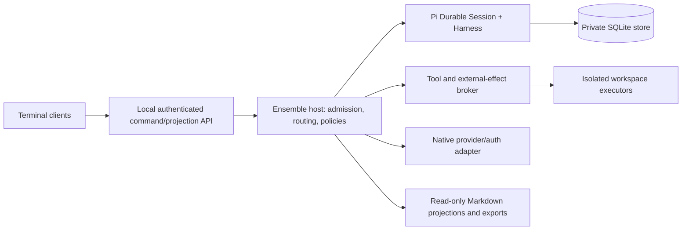

# Pi Ensemble design — proposal v1.1

**Status: amended after [Astra v1 review](../project/reviews/astra-design-v1-findings.md); [author disposition](../project/reviews/astra-design-v1-disposition.md) records AD1–AD4 and implementation gates. Not implemented or operator-approved architecture.** Preferred direction C is accepted; the mechanisms below are proposed. No host, attachment, sandbox, crash-recovery or rollover experiment has run. Source reading is not test execution.

## 1. Product and first useful increment

A local host owns persistent logical agents; attachable clients inspect and talk to any agent, including after it finishes a task. Each agent has an independent bounded context. An operator-selected project roster may have one agent, peers, drivers and workers, or multiple workstreams; role names are profiles, not singleton addresses or model rules.

The first usable increment is deliberately smaller than autonomous coding: launch a foreground host, create two independent persistent agents, attach/detach terminal clients, send direct questions and bounded peer tasks, inspect delivery/results, stop/restart the host and follow up on finished work. Use fake providers/effects for fault testing; enable one real provider only after its native authentication path is tested. No general shell, external writes, automatic spawning or unattended mutation in this increment.

Then add sandboxed worktree execution, revision-bound approvals, and verified context replacement. Do not market the first chat/control slice as satisfying all requirements. [Implementation plan](../project/implementation-plan.md) names release gates and deferred work.

## 2. Evidence and alternatives

- [Official Durable matrix](../project/research/durable-source-findings.md): independent conversations, transactional app documents, inbox request deduplication, scheduler/recovery and committed-state projections fit this host. Durable is not a daemon, transport, permission system, cross-process lock, logical-agent router or exactly-once external-effect service. Experimental API and selected latest-source drift require a release-pin gate.
- [Work report](../project/reports/work-setup-insights.md), [intake](../project/findings/2026-10-19-work-report-intake.md) and [Astra intake](../project/reviews/astra-work-report-intake-v1.md): persistent specialist access, independent verification, steering relay and dual-writer failures support the target. Two final four-role episodes do not establish an optimal roster or a causal cost result. Imported R-n identifiers are not repository requirement IDs.
- [Architecture alternatives](architecture-options.md): retain improved CLI peers as migration/control baseline A. They may cheaply fix reply ergonomics or stale setup prompts, but do not establish integrated host-owned recovery/ownership/control. B risks two persistence/replay authorities. Choose C provisionally for integrated semantics; defer D (CLI adapter) until one protocol works. If release/auth/ownership spikes fail, report the failed premise and revisit the boundary rather than implement another scheduler silently.
- [Ecosystem source matrix](../project/research/ecosystem-source-findings.md): latest subagents can revive eligible retained child contexts, which mitigates historical follow-up friction but is not an always-addressable logical agent. Intercom offers useful correlation/receipt states, but its disconnected mailbox is bounded in-memory state. Cloudflare confirms single replay owner plus app transport/wake policy; demo authentication is incomplete. Pi Pocket supplies an attach/control reference, explicitly not a process sandbox. Reuse these boundary/receipt/projection patterns, not whole packages as assumed Durable extensions. All compared source/tests are inspected, unrun.

## 3. Components and authority

Implement in TypeScript, using a compatible released Pi Durable/Pi-AI set selected and locked in the first spike. Prefer Node's supported SQLite backend if its release/runtime combination passes conformance; do not invent a version pin from inspected main SHAs. One project store and one active host owner per project initially. A host may later open several projects with independent locks; no distributed multi-host or synchronization.

**One execution authority:** Durable schedules execution, retries, waits and recovery. Ensemble app documents own logical routing, authorization and external-operation state. A durable delivery task bridges accepted app intents to native inbox submissions; it is not a second agent loop or transcript replay engine. No independent SQLite coordination database beside Durable in v1. Custom document/transaction compatibility is a release-gate test.

**Authoritative split:**

| State | Owner |
| --- | --- |
| Native transcript, submission settlement, execution tasks, checkpoints | Durable |
| Logical agents/incarnations, work assignments, control revisions, command/message receipts, driver obligations, approvals/effect intents | Ensemble app documents in the same Session |
| Actual workspace content, branch/HEAD and dirty state | Git/filesystem, checked before mutation or handover |
| Actual external action/result | Remote service plus reconciliation evidence, not a local success flag |
| Intent, ratified decisions, project explanation | Human-readable project artifacts; reviewed revisions bind tasks/authority |
| UI summaries, continuation/status exports | Derived projections, revisioned and rebuildable |

A Markdown edit never directly changes an operational lease or approval. Detect it as a new project-input revision and require reconciliation of affected work. Human decision edits remain meaningful inputs, not casually overwritten generated state. Use one tracker projection maintainer; independent reviewers write separate artifacts.

## 4. Identity and stored records

All records have schema version, stable ID, revision and causation/time fields. UUID-like IDs are opaque; human aliases are mutable labels. IDs do not encode mandatory role counts or session suffixes.

| Record | Essential fields |
| --- | --- |
| Project | ID, input revision, control revision, `awaiting_offline_update / ready / paused / stopping / stopped / faulted`, policy and store version |
| Logical agent | ID, profile/model config revision, active incarnation ID, route epoch, lifecycle, capacity; role is not unique |
| Incarnation | ID, logical ID, native conversation ID, epoch, `preparing / active / draining / archived / blocked`, handoff reference |
| Work item | ID, scope/acceptance/artifact refs, dependencies, assignee ID, assignment revision, driver/result destination, authority revision, status, lineage |
| Message | ID, sender, target logical/work-item route, correlation/reply IDs, payload reference/hash, reply obligation/deadline, pinned delivery incarnation/submission, receipt/state |
| Effect | Logical operation ID, attempt IDs, action/payload revision, actor/epoch/assignment/control revision, approval, `prepared / executing / confirmed / uncertain / rejected`, reconciliation evidence |
| Resource lease | Canonical repository/worktree or tracker identity, owner incarnation/work item, lease generation, active tool inventory; no clock expiry alone grants a successor mutation |
| Decision/approval | ID, owner, affected scope, question/evidence/options, exact action/target revision, resolution, expiry/revocation where applicable |
| Handoff | Common-core and per-agent input revisions, bounded summary, exact workspace/operations/messages/decisions, deterministic validation result |

Work-item statuses distinguish queued/running/blocked/continuation-ready/completed/failed/cancelled. Completion ends a work item, not a logical agent. A result can be rejected by acceptance owner without silently reopening an executed effect. A continuation is a new bounded work item with predecessor lineage.

## 5. Local protocol and client attachment

Start with a private local Unix-domain socket (parent directory 0700, socket 0600, startup ownership checks); no TCP listener. Same-user access is the initial trust boundary, not protection from a compromised account. Do not expose the socket to workspace sandboxes. OS-specific transport adapters are permitted, but unsupported permission/peer checks fail startup rather than fall back to a public port.

Versioned framed JSON commands include `protocolVersion`, `commandId`, `projectId`, target IDs, expected revisions/epoch where applicable, and bounded payload. Commands: `agent.create/list/inspect`, `attach`, `input.submit`, `message.send`, `work.assign/report`, `decision.resolve`, `control.pause/resume/stop`, `rollover.request`, `status/export`. Human-only operations are rejected from agent/tool principals. `input.submit` identifies `question` versus `steer`; default for direct human input to an assigned agent is conservative steering notification, not silent question-only handling.

Persist command ID + principal + canonical payload digest and receipt. Exact retry returns the original receipt; reused ID with different payload/principal is a conflict. Receipt means durable admission, not completion. Return separately the native submission, reply/result, uncertainty or rejection. Bound frame size, queue size and subscriptions per client. Protocol errors disclose no secrets.

Attach yields a fresh committed snapshot with projection revision and agent/task/message/control state; watch updates may coalesce. Slow clients receive `resync_required` then a new snapshot, not an invented complete event replay. Snapshot plus revision reconciliation is sufficient initially; audit exports are separate. Disconnect never cancels an agent. Historical attachment is explicitly read-only; attaching to a logical address follows a completed route cutover and shows its event.

## 6. Admission, messaging and result obligations

1. In a Session transaction validate command identity, caller capability, project/control state, task/assignment revisions, target lifecycle and capacity. Store the command receipt, message/work intent and delivery obligation atomically. Reject stale/mismatched inputs visibly.
2. Delivery state is `pending → claimed → submitted → settled`, with explicit `withdrawn / uncertain / blocked` outcomes. Persist the immutable payload/digest and a durable wake obligation with initial admission, using supported transactional task admission if available; otherwise a deterministic startup recovery scan must recreate missing wake tasks from nonterminal obligations without dispatching before the startup gate. A claim/pin transaction serializes with pause/drain/cutover, rechecks lifecycle/control/route/assignment revisions, and records the exact immutable native draft, destination and request ID **before** submit. The claim is part of the predecessor inventory even if native admission is unknown. Drain/cutover cannot pass it. Pause/stop atomically fences new claims; an earlier claim is accepted in-flight work, requiring reconciliation/withdrawal/settlement, not silent re-routing or a claim that cancellation was instantaneous. The execution gate in §9 prevents an implicitly resumed native task from bypassing control. If the host crashes between native admission and app receipt, retry only the exact pinned draft/request when allowed by reconciled control state; never rebuild it from changed Markdown/policy or choose a new incarnation while admission is unknown.
3. Preserve native settlement ID/outcome and separate app states `admitted`, `submitted`, `settled`, `result_delivered`, `failed/uncertain`. Recovering app delivery must not resubmit previously processed text as a fresh prompt. Verify request-ID deduplication retention in the release spike. The inspected source checks duplicate submission type, not same-type content; Ensemble must enforce canonical payload/draft digests itself, including on retries and changed artifact references. Park any uncovered admission gap rather than promise deduplication.
4. Replies retain `inReplyTo` independently of whether anyone is synchronously waiting. An expired wait does not invalidate a late result. Work-item/assignment routes, not a role-name broadcast, determine current responsible recipients. Stale results are evidence for the original attempt and reconcile with the current owner; they cannot revive an archived writer.
5. Task dispatch creates a durable result obligation. `work.report` explicitly completes/blocks it; terminal prose alone is not delivered output. End-of-turn missing-result checks surface a badge or bounded reminder, not an infinite callback loop. FYIs have no reply obligation.
6. Requests wait asynchronously; clients can watch working/idle/blocked/tool status without holding an agent model turn open. Deadline creates `overdue`, not success/consent. Idle without a result surfaces `response_missing`; it does not prove the peer crashed or justify duplicate execution.

App-level outbox/native inbox are a two-step bridge, not a cross-store transaction. All crash windows are acceptance tests. Transport delivery, inbox injection, model compliance, task acceptance and external effect completion remain distinct.

## 7. Direct steering and decisions

At **admission**, not only at agent end, atomically record the original human input reference, steering ID, target/work/assignment revision, and durable notice obligation to the responsible driver(s). Mark affected work `steering_pending`; block new dependent dispatch and new mutation admission in that scope. Existing in-flight tools may finish or become uncertain; never pretend the notice cancels them.

Deliver input directly to the selected agent with no driver approval hop. A compact semantic delta can follow, but raw input reference and scope/revision come first; an LLM summary is not the sole record. The agent reports changed intent, affected work and unresolved questions. Driver acknowledgment and semantic reconciliation are separate statuses; a missing/offline driver keeps dependent work held and is visible. Unaffected work may proceed. Conflicting steering becomes a decision request, not last-arrival-wins guessing.

Each steering event creates individual outstanding obligations bound to steering/input ID and revision, scope/dependency closure, assignment and driver revision. Add `steering.reconcile` (or equivalently specified typed transition) with authorized owner, exact obligation IDs, expected revision vector, disposition, affected dependent work and resulting plan revision. Transport receipt, driver acknowledgment, plan reconciliation and resumed authority are separate facts. A serialized compare-and-set satisfies only the named still-current obligations; scope becomes runnable only when **all** applicable obligations/dependencies are resolved under current authority. S1 acknowledgment cannot clear S2; an old-driver report cannot release reassigned work. Reassignment preserves or explicitly reissues unresolved obligations, never drops them. Multiple responsible drivers must each discharge their required obligation; ambiguous scope remains conservatively held at the whole assigned work item/dependency closure until clarified. Explicit `question` inputs do not create steering holds unless promoted to steering with a recorded event; they still cannot smuggle mutation authority. Driverless layouts allow the authenticated human/project owner to inspect and perform the same revisioned reconciliation operation directly.

Workstream drivers are explicit per assignment. Changing driver updates its revision and reroutes outstanding obligations with provenance. In a driverless layout use an explicitly configured human/project owner inbox; no nonexistent orchestrator is assumed. One steering ID prevents echo re-notification; automatic notification is not automatic broadcast of private pane text to every peer.

A decision request stores evidence, options, consequence, affected scope, correct owner and next bounded action. Timeout is never approval. Permission failures stop the affected action and request the proper authority; no automatic home-directory credential search or secret migration. Read-only diagnostics may continue only within the authorized scope/budget.

## 8. Effects, tools, credentials and writer isolation

Host-owned trusted adapters are the only route to tools. Capabilities apply to every ingress: direct tools, codemode nested calls, delegation and peer requests. A peer cannot lend authority. Arbitrary coding-agent extensions are **not** loaded into the host by default: they execute in-process and would bypass this boundary. Skills are reviewed data; executable hooks/plugins need explicit installation trust and policy review.

No unrestricted same-user shell is described as read-only. Introduce a sandbox executor before general shell/code execution: private process tree/PID and filesystem view, clean allowlisted environment, no credential directories/host socket, writable mounts only for leased workspace/scratch, no network by default, explicit bounded output/runtime. A read-only reviewer may run tests in disposable writable scratch derived from a snapshot, not mutate the author's worktree. Process startup and actual write/effect admission recheck epoch, assignment and control revision. Host adapters, not arbitrary shell, perform authenticated external actions.

Executor ownership must survive a **host** crash, not just child cancellation: each platform adapter must establish a stable discoverable containment identity before writable access, using a crash-safe launch/registration handshake. Persist launch intent and containment identity; the executor cannot start mutation before registered authorization is granted. Recover a crash at every handshake boundary by discovering and terminating/reconciling prior owned containment scopes, or block new writable access. PIDs/heartbeats and the store lock are not proof of identity or process death. Detached descendants and retained writable descriptors must remain in the discoverable/revocable scope; if the adapter cannot establish that old mutation capability is gone, the workspace stays blocked. Revocation waits for proven exit or a tested OS mechanism that actually removes writable capability; epoch checks at launch do not mediate every filesystem write.

Sandbox feasibility and supported OS adapters are an unresolved release gate. The first slice is tool-restricted; if isolation cannot be demonstrated on a target laptop, do not silently enable unsandboxed mutation. Portable identity/protocol/storage do not by themselves prove portable OS confinement. Linux may supply the first reference adapter; another OS requires equivalent tests or remains mutation-disabled. Operator acceptance is required before calling that a useful portable coding release.

Workspace leases use canonical git common-dir/worktree identity plus branch/ref conflict checks. The host verifies HEAD/dirty state and owns lease generations. Different worktrees do not authorize concurrent updates to the same remote branch. External/manual changes invalidate the checked revision and require reconciliation. Review/evidence writers use separate worktrees/artifacts. Lease timeout or a new alias never proves an old process stopped.

For an external mutation, persist intent and exact revision-bound approval before execution, then assign an attempt. Use service idempotency keys or query/reconcile by a stable action identity when available. A crash after execution without receipt yields `uncertain`; no automatic destructive replay. Approval binds exact target, payload/HEAD and scope; retries cannot enlarge it. Stop/replacement does not renew approval. No automatic merges, publication or production mutation from classifier output.

Credentials stay in the native private provider store/host adapter. Reuse supported native subscription/key resolution only after a test; do not copy OAuth tokens into a new file or assume chat subscriptions are API keys. Clients, tools, workers and telemetry receive neither secrets nor the full host environment. Errors are redacted. Real provider validation is separate from the already successful direct TypeSafe codemode smoke.

## 9. Pause, stop, startup and host ownership

Hold an OS-backed exclusive project-store lock **before opening** Durable and creating provider/tool activity. A PID file alone is insufficient. Lock acquisition/release, two-host races, stale process metadata and unsupported filesystems require a platform test; do not break a lock solely on heartbeat expiry. Private runtime state lives outside public Git; backup with the host stopped or a tested consistent snapshot.

Startup execution states are `opened_execution_disabled → reconciling → awaiting_offline_update → enabled`, with fault/paused/stopped states remaining execution-disabled. Separate public app-admission fencing from **actual native task/provider/tool dispatch**. The inspected native `submit()` and submission `wait()` implicitly call scheduler resume; withholding explicit `resume()` alone is insufficient. Before confirmation expose only proven non-executing metadata/snapshot/watch paths; do not call wait/submit as inspection or bootstrap recovery. M0 must demonstrate a supported control-aware dispatch/parking mechanism for recovered native generation/tool tasks **and** app delivery tasks. If only provider/executor boundaries can guard them, prove zero provider/tool starts, no new peer work and no hot retry before authority is enabled. If supported APIs cannot do this, the spike reports a blocker and revisits the boundary—no second task runner or implicit resume workaround. The persisted obligation scan can inspect/repair metadata without scheduling, with one explicit enable path after reconciliation/confirmation. M1 must implement this minimum stop/restart gate; rich scoped controls may follow in M2.

On reopen reconcile stored control revisions, native recovery, operation uncertainty, active executors/leases and app delivery obligations before enabling execution or mutation. Show API/Git offline deltas and ask for human offline updates; remain `awaiting_offline_update` until explicit confirmation. Read-only inspection is available. This is a deliberate execution gate, not automatic Markdown overwriting.

- **Pause project:** increment control revision, deny new work and mutation, request bounded checkpoints. In-flight effects remain visible; a paused badge is not a claim all tools stopped.
- **Stop agent/project:** fence new admission, withdraw queued inputs where supported, abort owned foreground/background scopes explicitly, terminate registered sandbox process groups and wait for exit. Record unresolved remote effects/unkillable code. Do not report `stopped` until tracked local execution has exited; otherwise `stopping/blocked`.
- **Emergency stop-all:** priority control path bypasses ordinary task queues, persists fencing first, then aborts/terminates. It cannot revoke a remote effect already accepted.
- Late callbacks/results append evidence without starting new model work while paused/stopped. Explicit human resume reconciles outstanding uncertainty; restart does not manufacture resume authority.

## 10. Context and replacement contract

Use [bounded tasks](task-contract.md) and [lifecycle](context-lifecycle.md). Initial bootstrap policy for these sessions is 272K ceiling with wind-down at 220–230K. Proposed runtime reference profile uses `C = min(operator ceiling, model window)`; reserve output/control/tool/handoff headroom within C and begin draining no later than min(220K, 0.80C), earlier if predicted growth requires it. This is the reference policy for v1.1; earlier lifecycle-document numbers are alternatives, not competing defaults. Exact policy is reviewable, not a measured optimum. Smaller model limits override all large-window values. Reject/split large reads before exceeding remaining budget; count cached tokens as context and label estimates. Starting at M1, reserve/revalidate the **assembled next model request** at generation/injection boundaries, including accumulated queued inputs, concurrent tool results, schemas/system material, attachments and output/control reserves. Per-message checks alone are insufficient. Park oversized requests or replace bounded low-level output with explicit artifact pointers; never silently drop authority-bearing instructions. Include estimation error margin and a safe unavailable-tokenizer policy. Handoff caps below are maxima, not entitlements on small-window models.

Choose **fresh conversation/incarnation for deliberate rollover** in the first implementation: explicit lineage and archived history are easier to inspect than pretending context never changed. Defer automatic compaction to a separately evaluated optimization, not an upstream requirement or banned primitive.

Protocol:

1. CAS active epoch to `draining`; deny new substantive task admission, queue unpinned messages, notify driver/clients. Urgent steering/control still records durably.
2. Inventory accepted inputs, submissions, child tasks, process groups, approvals, effects and workspace state. Settle native submissions already pinned to predecessor or park visibly. Do not migrate an uncertain injection into a successor. Pending app messages not yet pinned may wait for cutover.
3. Quiesce mutation and verify local executor exit. Persist a compact manifest (target budget <=8K tokens, hard configurable cap <=16K), common core plus assigned focus, exact revisions/operations/messages and next bounded task. Checkpointing an effect is not proof it did not happen.
4. Prepare successor read-only; validate mandatory manifest fields, artifact/HEAD hashes, operation/assignment/control revisions and semantic scope/decisions against evidence. Any steering/input change invalidates readiness. Model/Jev assessment may flag omissions, never grant authority.
5. Readiness binds an immutable manifest hash plus exact common/per-agent input, assignment/driver, policy/control, workspace, claimed-delivery inventory, decision and approval revision vector—not a bare `ready` flag. Semantic validation may return uncertain/needs-decision; deterministic matching cannot prove completeness. In one app transaction compare that vector and recheck quiescence/readiness/revisions, increment route epoch, activate successor, transfer eligible leases and mark predecessor archived. Since native and external state are not magically moved, no live submission/tool/effect may require implicit ownership transfer. If uncertain, block rather than cut over.
6. Deliver queued unpinned intents to new epoch, notify driver and clients. Late old results retain provenance and need current-assignment reconciliation. Historical questions use a fresh read-only inspector over bounded archived references, not a reactivated obsolete writer.

Crash during preparation restores the old draining owner or a blocked transition; after committed cutover the new epoch is authoritative. Never rollback by merely flipping the pointer back: a failed successor needs its own settlement and a new forward epoch. Automatic rollover may provision at most one prepared successor per logical agent and obey project spawn/concurrency caps; continuous unfinished work does not authorize unbounded agents.

Horizontal split creates separate child work items/owners and aggregation routes; reassignment increments assignment revision after old-owner settlement. Neither operation is disguised as rollover. Common continuation plus per-agent focus is selected deterministically at a checked revision; do not copy full maps/histories into workers.

## 11. Budgets, observability and Jev

Admission enforces configured limits for live agents, active generations/tools, provider concurrency, total turns/hops/retries, wall time, spend and context. Initial defaults are conservative explicit configuration, not unlimited inherited permissions. Result/FYI loops do not trigger unlimited replies; terminal messages are terminal. Unknown cost is unknown, not free. Exhaustion parks work with a next-action/decision, not silent retry.

[Portable event core](observability.md): schema-versioned decision/action/outcome records correlate project, logical agent, incarnation, work/assignment, steering, message, operation/attempt, approval and verification IDs. Audit-critical command/approval/effect/control records commit with app admission. Informational usage exporters may fail visibly without halting unrelated reads. Exports deduplicate events but preserve every provider/effect attempt and uncertain billing. Store payload references by default; raw prompts/private state opt-in only.

Direct TypeSafe Jev is selected and [smoke-tested](../project/findings/2026-10-19-jev-smoke.md). Add instrumented native codemode/host adapters around the same core. First meaningful use: recommend review attention for bounded evidence packages with a fixed, independently reviewed rubric including insufficient evidence; caller baseline remains outside the request. Record actual action and later independent outcome. Controlled paraphrase/label/polarity tests gate claims of recurring rubric reliability. A service outage records unavailable and leaves deterministic rules intact; no hidden paid fallback. Native unwrapped calls remain a declared measurement gap.

## 12. Verification, migration and outstanding decisions

Blocking tests: two-host exclusion; admission crash windows; same-command changed payload; attach/resync; post-completion follow-up; missing result visibility; steering/cutover races; stale-epoch tool rejection; non-cooperative child termination; uncertain remote effect; approval revision change; smaller-window drain; missing/changed manifest; safe stop/restart and bounded loops. Use deterministic providers, temporary repositories and a fake external service before real mutation. See the phased plan for exact gates.

CLI-peer workflow remains usable alongside the prototype, but must never share an active writer lease/branch with it. Import only reviewed project docs and bounded summaries; no live transcript migration or global config rewrite. Export Markdown plus versioned JSON records. Upgrade only with host stopped, backup and tested schema/task-definition migration. Rollback restores a compatible binary and snapshot only when no later external actions require reconciliation; otherwise forward recovery/park, not database time travel.

**Astra must assess:** one-store app/native bridging feasibility; real executor fencing and portable isolation; steering hold granularity; context/handoff fidelity; first-slice scope; release/auth compatibility; whether reuse of latest packages changes the boundary. Experiments are deferred to immediate implementation gates, not asserted successful. M0 explicitly selects supported OS/runtime/filesystem and SQLite durability settings, and distinguishes process-kill recovery from power/host-loss survival; receipt durability claims cannot exceed the tested failure model. Operator acceptance remains required for consequential architecture and supported-platform/mutation scope.
