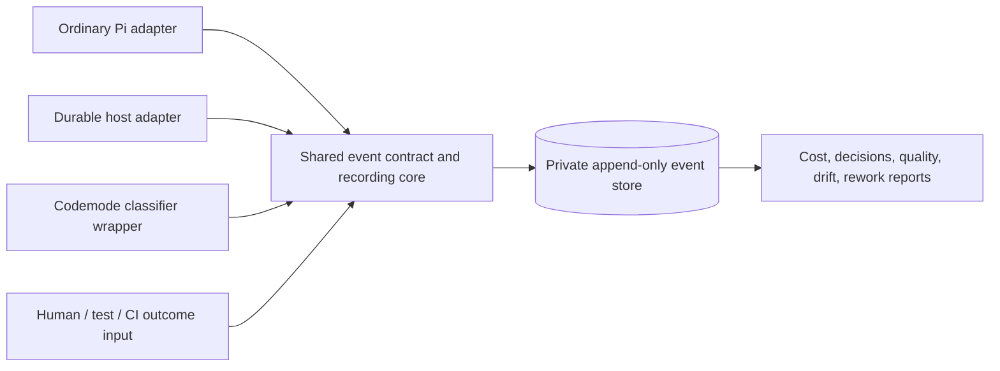

# Portable decision and outcome observability

Status: proposed requirements and component boundary; no collector or package is implemented yet.

## Why native metrics are insufficient

Token totals and latency show resource use, not whether Jev or an adviser improved a decision. We need to connect **question → prediction → action → result → independent assessment**, across agents, retries, and later human interventions.

This applies beyond Jev: delegation, reviews, ambiguity escalation, steering, acceptance checks, and discarded work all have outcomes. The measurement design must survive replacing a UI, a provider, or the hosting harness.

## Proposed reusable boundary

A reusable library/core with thin runtime adapters is the preferred direction to investigate—not a mandatory giant observability platform. A Pi extension can host an adapter; a Durable host uses the same contract directly. Packaging is still open. Do not force a CLI extension into a host that does not run the coding-agent CLI.

No adapter can universally observe arbitrary uninstrumented network calls or know an eventual correct answer automatically. All supported classifier call paths, including codemode, must route through an instrumented boundary or clearly report a coverage gap.

## Minimal proposed event contract

Names/fields are design vocabulary, not an implemented API.

| Group | Required information |
| --- | --- |
| Identity | Event ID, schema version, timestamp, project/agent/work-item IDs, conversation/run/task references where available |
| Correlation | Decision ID, trace/causation IDs, input/action revision, attempt ID; stable idempotency identity separate from execution attempt |
| Question | Purpose, criteria/rubric ID and revision, safe input reference/hash, provider/model/returned revision when available |
| Prediction | Typed answer, probabilities/confidence where provided, abstention/error/unavailable status |
| Action | Recommendation versus actual action, actor/authority, override/steering reason, coordinator notification/acknowledgment |
| Resources | Reported input/output tokens, duration, retries, actual/reported/estimated/unknown cost, rate and provenance |
| Outcome | Verification/evidence reference, review acceptance/rejection, human correction, avoidable rework/discard, outcome label and label source |

Persist a decision/call identity before execution when supported, then record its result and downstream action. Deduplicate logical events after restart, but count each actually billed attempt: deduplicating an event is not deduplicating a provider charge. Interrupted/unknown attempts must stay visible.

Keep the record useful without embedding secrets or raw source. Hashes are correlation aids, not anonymization guarantees; even input hashes may be sensitive. Raw payload retention is opt-in and private. No automatic upload or public telemetry.

## Reports that answer useful questions

- **Cost/latency:** reported usage, rate-based estimates, unknowns, provider reconciliation, time waiting versus working.
- **Decision quality:** labeled confusion, false reassurance, false positives, abstention, calibration only with enough appropriate labels.
- **Incremental contribution:** what changed because of Jev/adviser versus deterministic/agent baseline; correlation is not a causal result.
- **Steering/drift:** redirects, notification lag/failure, stale-plan work, dependent tasks invalidated.
- **Escalation:** ambiguous decisions surfaced early versus late; justified requests versus unnecessary human interruption.
- **Rework:** completed work kept, amended, or thrown away; attributable reasons and affected scope, with uncertainty rather than fabricated dollar savings.

Outcome labels may arrive later. Append assessment/correction events rather than silently replacing the original prediction. Agreement between agents is not an independent label; tests, human adjudication, and external results should identify their provenance too.

## Durability and failure policy

- Instrumentation must not expose secrets or silently convert failed/unknown decisions into success.
- Avoid double-counting nested calls already represented in native usage. Show application estimates separately from harness totals and provider billing.
- Decide which records must be transactionally tied to admission/actions and which can use a durable outbox; do not promise atomicity across separate stores.
- A metrics sink outage should be visible. Audit-critical mutation evidence may need to fail closed; ordinary informational metrics need not halt unrelated work. The concrete design must classify this, not use one blanket behavior.
- Export a documented versioned format so another runtime/package can consume it. Start small and local; dashboards and remote infrastructure are not MVP prerequisites.

## Acceptance scenarios

1. One codemode batch and one direct host classifier call produce comparable correlated decision records.
2. A provider error, unknown pricing, missing model revision, and an interrupted call remain explicitly unknown—not zero-cost successful decisions.
3. Reopening/retrying does not duplicate logical reports or erase billed attempts.
4. A human disagrees with Jev and later evidence resolves the disagreement; reports preserve all stages.
5. Direct human steering updates the driver and invalidates affected work; notification lag and discarded work are measurable.
6. An uninstrumented path is reported as a coverage gap, never advertised as universal completeness.

See [decision-model integration](decision-models.md) and [requirements](requirements.md).
