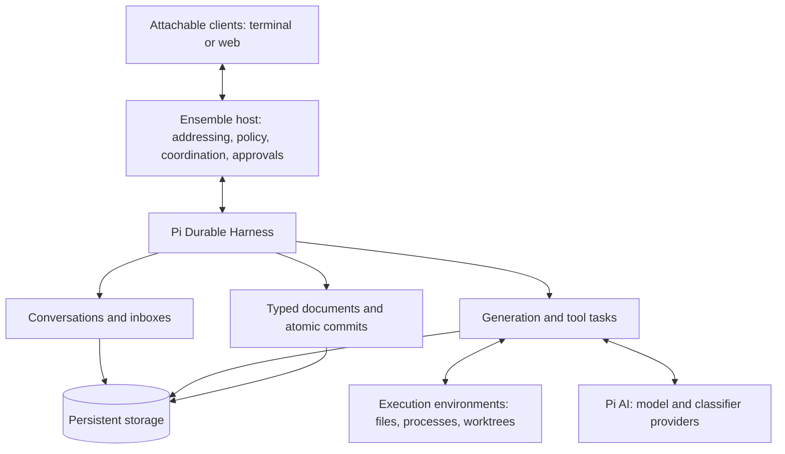
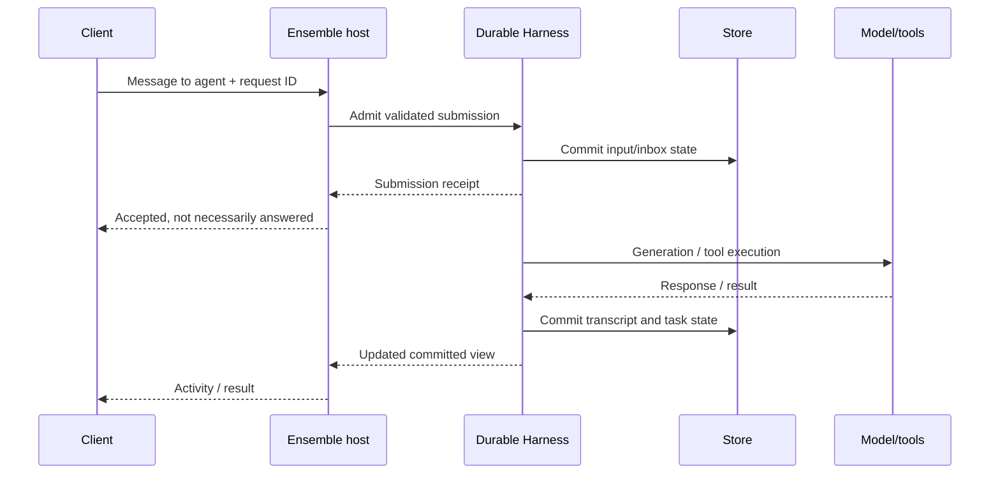
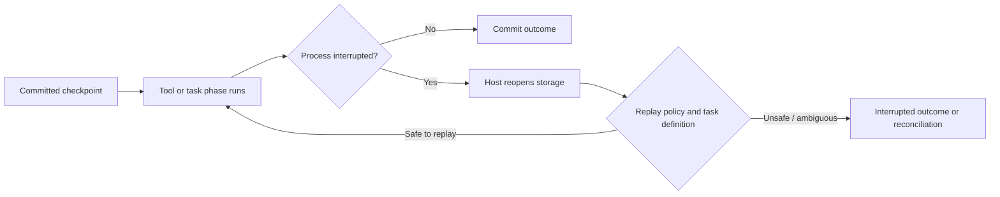
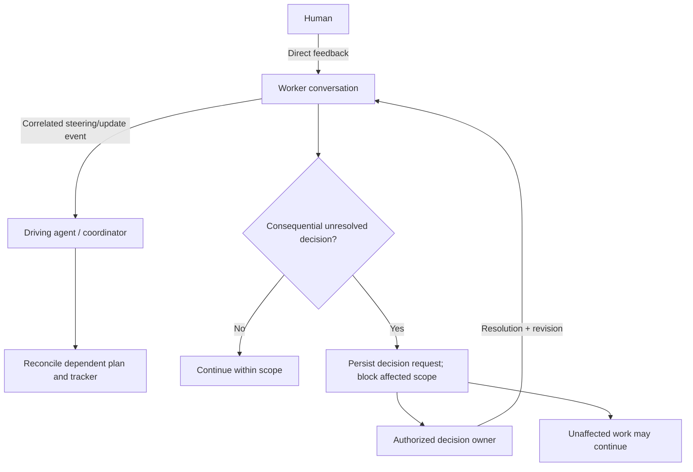

# Pi Durable explained

## In one sentence

**Pi Durable is a library for running agents whose conversations and execution state survive the process that was running them.** It is a substrate on which to build an attachable runtime—not an already-installed daemon, a terminal multiplexer, or a drop-in replacement for every Pi CLI extension.

This explanation follows the [pinned official README and background-agent example](../project/research/sources.md). It separates documented substrate behavior from proposed Ensemble behavior; the full normative-spec review and recovery experiments are still pending.

## The layers

- **Pi AI** supplies model/provider access.
- **Pi Durable** supplies conversations, durable submissions, task execution/recovery, committed state, and views.
- **Ensemble** must supply the product: agent membership/lifetime, role policies, peer addressing, client protocol, project state, ambiguity handling, approvals, worktree ownership, and outcome observability.
- **Clients** display and interact with that product; closing one should not own or end agent work.

Ordinary Pi CLI extensions use the coding-agent `ExtensionAPI`. Durable extensions use a registry of tools, hooks, prompt sections, and task definitions. Similar names do not imply binary/API compatibility.

## Vocabulary

| Concept | Meaning | Not the same as |
| --- | --- | --- |
| Harness | Open storage plus machinery executing work against it | A complete desktop/server application |
| Conversation | Independent persisted transcript and per-conversation configuration | One disposable task or necessarily one OS process |
| Agent configuration | Model, thinking level, tools, selected extensions, instructions, cwd | All enforcement/sandbox policy |
| Submission | Durably admitted input or entry, with a handle/identity and eventual outcome | Merely bytes written to a socket |
| Task | Checkpointed state machine with ownership and restart behavior | An arbitrary shell process made magically transactional |
| Document | Typed JSON state changed in commits alongside entries/tasks | A Markdown file automatically synchronized to disk |
| Commit | Atomic update to the harness store | An atomic transaction across Git, files, APIs, and billing |
| View/watch | Current committed state and subsequent changes for clients | A guaranteed replayable event log from any old cursor |

An Ensemble logical agent can be associated with a conversation and additional identity/lifetime state. That mapping still needs design; do not equate a provider session ID, conversation ID, task ID, and public agent address.

## What a user message does

The receipt means admission, not success. A busy conversation can accept a steer, queue a follow-up, or reject input according to the chosen mode. Stable request IDs can deduplicate repeated admission, but application routing and correlated updates remain host responsibilities.

## The tmux analogy—and its limits

| tmux intuition | Ensemble equivalent |
| --- | --- |
| Session continues when the terminal detaches | Host owns agent work, not the attached UI |
| Attach to a pane | Select a logical agent, obtain a snapshot, follow activity, send input |
| Several panes show different work | Independent agent conversations and summaries |
| Reattach later | Reconstruct the current view from committed state; preserve agent identity/context |

The analogy is about ownership and attachment, not literal PTYs. Pi Durable does not itself provide an `ensemble attach` command. If the host process is not running, work is not magically progressing: the host/supervisor must restart, reopen storage, reinstall the needed definitions, and resume scheduling.

Task completion must be separate from agent retirement. An idle agent can remain addressable for questions and adjustments without paying for continuous model turns. Context should be budgeted and eventually compacted or handed off; persistence is not an infinite model window or a promise of everlasting provider prompt-cache hits. Ensemble must design [context wind-down and replacement](context-lifecycle.md) separately: stable logical addresses, compact verified briefings, and safe rerouting are not automatic consequences of persisted transcripts.

## Restart and external effects

A tool's intent can be committed before execution. If an external effect happens and the process dies before recording the result, replay may duplicate the effect. Replay-safe tools still need appropriate idempotency. Unsafe interrupted tools are not automatically safe to repeat just because the model wants to continue.

Examples: a file read is unlike a push, a merge, a payment, or posting a message. Even an apparently idempotent file write can overwrite newer work without revision checks.

The pinned README states one process owns a store at a time; it does not supply cross-process locking. SQLite defaults also distinguish process-crash durability from newest-commit durability under power/host failure. These are deployment contracts to address, not reasons to reimplement the scheduler.

## Peer work, steering, and ambiguity

This is **proposed Ensemble behavior**, not a built-in Durable approval/decision API. Direct human input should not require an orchestrator relay, but changed intent must not remain invisible to the driving agent. Reports should be correlated, durable, compact, and loop-bounded.

Agents should investigate ordinary factual uncertainty themselves. They should escalate when requirements, authority, conflicting instructions, or consequential alternatives cannot be resolved safely. A request should state the unresolved question, evidence, options, impact, and what is waiting. A cache expiry is preferable to expensive, confident work built on a false premise.

## What existing integrations teach

Cloudflare's Agents SDK includes an experimental Pi harness, and the official standalone Cloudflare example demonstrates shared/reconnecting clients, task activity, and hosting. The important reusable boundary is **one execution/replay authority, host-owned lifetime, replaceable transport/client**. Cloudflare-specific alarms, bindings, filesystem abstractions, and authentication are not automatically a local-laptop solution.

Some integration notes refer to older Pi limitations contradicted by newer docs, so inspect revisions and tests before copying design workarounds. See [the source register](../project/research/sources.md) for exact snapshots and inspection status.

## Where to go next

[Requirements](requirements.md) · [Architecture direction](architecture-options.md) · [Decision models](decision-models.md) · [Observability](observability.md) · [Current project work](../project/README.md)
