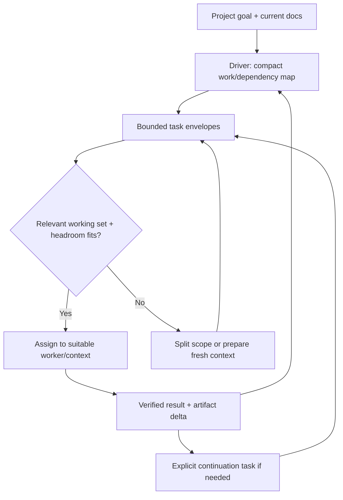

# Bounded tasks, continuation, and horizontal workers

Status: proposed runtime contract for review, not implemented schema/API. Complements [context lifecycle](context-lifecycle.md).

## Two related operations

- **Rollover** replaces the working context behind a logical agent while preserving a controlled identity/routing boundary.
- **Horizontal scaling** assigns independent, bounded work items to additional logical workers. It must not clone a giant conversation into every worker or turn one address into an ambiguous broadcast destination.

Both need a compact task/handoff contract and current project Markdown as a shared knowledge substrate. Neither justifies letting a worker's prompt grow toward a million tokens before acting.

## Project knowledge versus task instructions

Project docs hold goals, accepted decisions, architecture, conventions, current state, and evidence links. The coordinator maintains a compact map of work, dependencies, owners, and outcomes. A worker loads only its task's relevant slices.

A task should be **self-contained enough to execute with bounded retrieval**, not self-contained by embedding the entire project. References must be discoverable and revision-aware; missing critical context becomes a scoped clarification, not permission to guess or read everything.

Keep scope/instructions concise. If briefing a worker requires an enormous prompt, first reduce or split the task and improve the project artifacts. Do not disguise a monolithic project as one task plus hundreds of mandatory references.

## Task envelope

These are required concepts, not final field names or wire format.

| Part | Minimal content |
| --- | --- |
| Identity and intent | Stable work-item ID, bounded objective, why it matters, explicit in/out of scope |
| Ownership and route | Current logical assignee, assignment revision/epoch, responsible driver/decision owner, result destination, original caller correlation |
| Inputs | Relevant artifact paths/sections and revisions, prerequisite outcome IDs, small verified context summary |
| Workspace | Repository/worktree/branch/base revision and current writer ownership, if mutation is allowed |
| Deliverable and acceptance | Expected artifact/change, observable checks, evidence to return, stop/decision conditions |
| Authority and limits | Allowed actions/tools, approvals where relevant, bounded concurrency/context/usage policy, no assumed inherited authority |
| State and lineage | Dependencies, predecessor/continuation links, current status, already-completed effects/receipts, known uncertainties |

Pointers are not proof that artifacts are current. The worker checks critical revisions and exposes material drift. A runtime can admit/validate the envelope deterministically; the model still has to perform the work and may need clarification.

## Continuation is a task, not a transcript dump

When a bounded slice ends, the output should identify:

1. What was verified/delivered, with exact artifact/test/change references.
2. What remains, expressed as the next bounded objective and acceptance criteria.
3. Current workspace/operation state and what must not be repeated.
4. Open questions, decisions, dependencies, hazards, and responsible owner.
5. Minimal role-relevant context and just-needed project pointers.

If more work is needed, record an explicit **continuation work item** linked to the predecessor, retaining original request/acceptance lineage. Do not silently redefine the completed task, replay completed external effects, or bury changed scope in a long "next bit" message.

A successor/another worker can execute that continuation. The same logical worker may take it if its context and ownership remain suitable; continuity is not a requirement to keep stuffing one conversation forever. Do not recursively concatenate every prior continuation summary: summarize current remaining state, link immutable predecessors for selective lookup, and retain verified outcomes in the project substrate.

## Context-aware allocation

Before dispatch, estimate the worker's existing relevant context plus task inputs, expected retrieval/tool growth, and completion/control reserve. A good coordinator plans small useful slices and distributes detail; host admission/limits should still prevent accidental oversizing rather than trusting the coordinator perfectly.

- Reuse a warm context only where it is relevant and safely below budget; do not favor cache reuse over scope clarity or sound decisions.
- Use another/new worker when it reduces unrelated accumulated context and can own a bounded independent slice.
- Split tasks only at meaningful acceptance/dependency boundaries. More workers are not automatically cheaper or more correct.
- Respect writer ownership, API concurrency/rate/spend limits, dependency topology, and verification/merge capacity.
- Keep the coordinator's own context bounded: artifact/outcome pointers and summaries, not every source diff/log. The coordinator can also need rollover.
- Additional workers need only their scope and minimal shared core, not every sibling's findings. Independent review may deliberately overlap on specific evidence.

Exact size estimation, default task limits, and scheduling policy remain design work. Aggregate ensemble context is not one shared infinite model window.

## Routing and reassignment

Route work by **work-item ID + current assignment**, not only role name or whatever conversation last sent a message. A role may have several workers. The host needs a deterministic destination for a task, not an undifferentiated `worker` broadcast.

1. Persist the assignment and its revision/epoch before admitting execution.
2. Address steering, decisions, results, and continuation against the work item and current logical assignee; retain original causation and driver/result route.
3. Before reassignment, settle/checkpoint or explicitly block the previous owner's mutations/effects. A routing update does not stop a running shell process.
4. Deduplicate admission/retries; preserve billed execution attempts and evidence separately.
5. A late result remains attached to its original item/attempt and is reconciled with the current assignment. It is not automatically instructions for an obsolete conversation.
6. Inform drivers/affected peers of ownership/scope changes. Human direct feedback updates both current work and coordination state; no relay hop is required to speak to the worker.

Splitting one task creates explicit child work items with their own scopes/assignments and a defined aggregation/acceptance owner. Replacing one worker incarnation preserves its logical address through the rollover protocol. These are different transitions even if they use the same handoff format.

Reassignment does not grant new authority, refresh an expired approval, or erase unresolved effects. A continuation must carry enough verified state to prevent repeat work, but never treat the predecessor's unsupported assumptions as accepted decisions.

## Acceptance and Astra questions

- Can independent fresh workers complete scoped tasks from the same project docs without full parent history or mandatory sibling transcripts?
- Does an oversized task get split/reduced before dispatch, rather than expanding a worker toward a million-token context?
- Does continuation remain bounded across many generations instead of accumulating all prior summaries?
- Can rollover and horizontal split preserve work-item/acceptance lineage while having distinct routing transitions?
- Can messages/steering/results race reassignment without duplicate effects, lost decisions, or two mutation owners?
- Does parallelism respect worktree/dependency/budget limits and yield verified results that the driver can aggregate with small context?
- Are stale/missing project docs detected, and can ambiguous work wait without blocking unrelated tasks?

These questions belong in [Astra review](../project/reviews/astra-brief.md) and fault tests, not just role prompts.
